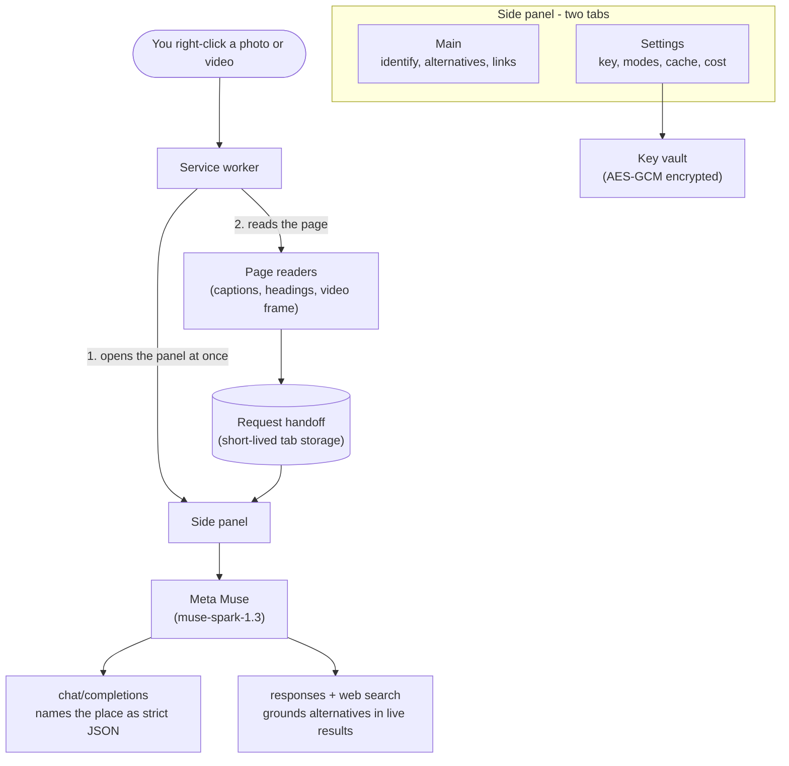

# Take me there

See a photo of a place you love? Right-click it, choose "Take me
there", and the extension identifies the place, right in Chrome's
side panel.

## Features

- **Place identification.** Right-click any image (or a video frame)
  and Meta's Muse AI tells you where it is, with a confidence score.
- **Alternatives.** Ask for cheaper, quieter, or similar options
  near the identified place.
- **Booking links.** Every result carries map and hotel deep links.
- **Honest pricing.** Every analysis shows exactly what it cost.
  Repeat views load from a local cache and cost nothing.

## Install

1. `npm ci --ignore-scripts`
2. `npm run build`
3. Open `chrome://extensions`, enable Developer mode, choose Load
   unpacked, and select the `dist/` folder.

## Use

1. Right-click a photo and choose "Take me there". The side panel
   opens and asks for your Meta Muse API key.
2. Paste the key, click "Agree & analyze". The place is identified.

Your key is stored encrypted on your own machine (see Privacy),
but anyone with full access to your computer account could still
recover it, so only save it on a trusted device. A session-only
mode keeps it in memory and forgets it when the browser closes.

## Privacy

- Saving a key sends only the key itself to validate it. Nothing
  else leaves your machine until you click "Agree & analyze".
- Analysis requests go to Meta's Muse API. Your key, images, and
  page text are used only to produce the result you asked for.
- Page images are downloaded only when needed, without your cookies,
  and the one-time permission is removed right after.
- No analytics, no tracking, no ads.

Stored on your machine, never uploaded anywhere except the API
calls above:

- Muse API key: AES-GCM encrypted in this browser profile (or memory
  only, in session-only mode).
- Cost totals: monthly spend.
- Result cache: recent results keyed by image and page, kept 7 days
  by default (1 or 30 days in Settings), at most 10 entries and
  2 MB, with a Clear control.
- Settings and consent flags: search modes, cache retention, Agree state.

## Architecture

## How Muse is used

All Muse calls go to `https://api.meta.ai`, model `muse-spark-1.3`
(plus `sam-3.1` for look-again crops). It is the only website the
extension talks to.

| Call                        | What it does                                               | What is sent                                 |
| --------------------------- | ---------------------------------------------------------- | -------------------------------------------- |
| `GET /v1/models`            | Checks your key when you save it                           | Key only, nothing else                       |
| `POST /v1/chat/completions` | Identifies the place and suggests alternatives             | Image plus page text (never without consent) |
| `POST /v1/responses`        | Grounds alternatives with live web search, crops landmarks | Place name plus your question                |

A typical analysis costs a few cents: tokens plus about $0.0025 per
web search or landmark crop, and nothing for cached repeats. The
panel shows the exact figure after every run, and a monthly total
on the Settings tab.

## Develop

- `npm run dev` - rebuild on change.
- `npm test` - the full suite (happy-dom, no browser needed).
- `npm run typecheck` - strict TypeScript, unused code flagged.
- `npm run format` - Prettier across the repo.
- `node scripts/verify-bundle.mjs` - confirms the bundles carry no
  `eval`-style code (Manifest V3 forbids it) and that the page
  readers ship inside the worker bundle.

## License

MIT, Copyright (c) 2026 Krzysztof Kowalczyk. See `LICENSE`.
Bundled open-source libraries are attributed in
`THIRD_PARTY_NOTICES`.
